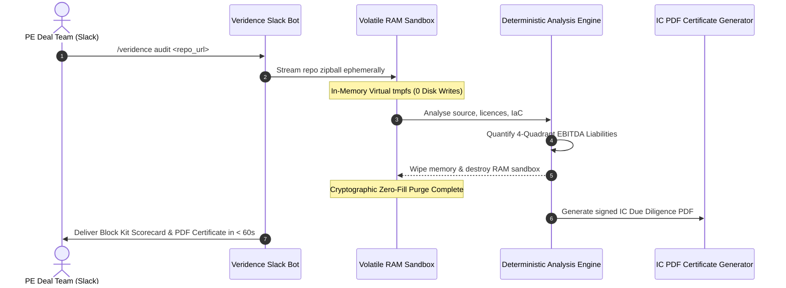

# The Sovereignty Protocol: Air-Gapped Code Privacy Architecture

Target company source code represents the primary asset in technology acquisitions. Conventional code evaluation tools that transmit code to public cloud APIs or generative LLM endpoints introduce critical confidentiality and data leak risks.

The **Sovereignty Protocol** enforces zero-retention data sovereignty through an ephemeral, memory-isolated runtime architecture.

---

## Architectural Sequence

---

## Core Sovereignty Guarantees

### 1. Ephemeral In-Memory Execution (tmpfs)
* Code repositories are uncompressed strictly within volatile, in-memory virtual filesystems (`tmpfs`).
* **Zero Disk Persistence:** No code files, syntax trees, or temporary artifacts are written to non-volatile storage.
* **What Is Sent Outside:** To look up the licence and published vulnerabilities of third-party packages, the registry, name and version of each open-source package a repository depends on are sent to the public Open Source Insights service (deps.dev). No source code, repository name or customer identity is sent, and the lookup can be switched off for a deployment.

### 2. Zero Generative LLM Transmission
* Analysis relies 100% on deterministic static analysis: syntax-tree analysis (Python's own parser; tree-sitter for JavaScript and TypeScript) and fixed pattern rules for licences, secrets, infrastructure and access policies.
* Code is **never** sent to OpenAI, Anthropic, Google Gemini, or any third-party model inference provider.
* Eliminates generative hallucination risk and guarantees complete immunity to model training exposure.

### 3. Immediate Cryptographic Destruction
* Immediately upon completion of calculations, the memory sandbox is destroyed.
* Memory pages are scrubbed and zero-filled, guaranteeing that no remnants survive past the execution lifecycle.

### 4. Dedicated VPC Deployment
* For enterprise funds with sovereign data mandates, Veridence deploys within dedicated, air-gapped Virtual Private Clouds (VPCs) on Oracle Cloud Infrastructure (OCI) or Google Cloud Platform (GCP).
